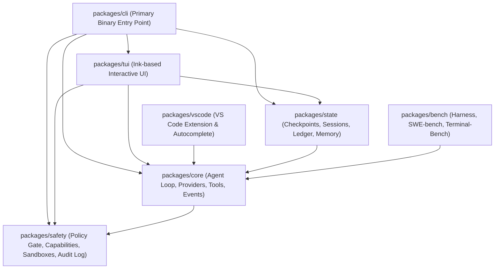
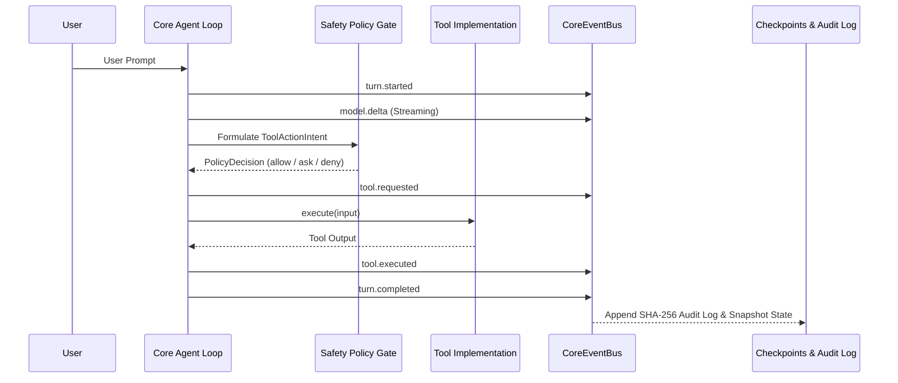

# Forge System Architecture

Forge is an open-source, model-agnostic terminal AI coding agent built with strict modularity, deterministic state transitions, and a defense-in-depth safety engine.

---

## 1. Monorepo Package Boundaries

The repository is structured as a pnpm monorepo with strict architectural boundaries:

| Package         | Path              | Invariants & Constraints                                                                                                                                  |
| :-------------- | :---------------- | :-------------------------------------------------------------------------------------------------------------------------------------------------------- |
| `@forge/core`   | `packages/core`   | **ZERO UI IMPORTS (EVER)**. Pure domain logic, event bus, model providers, and tool execution. Never references Ink, React, or terminal escape sequences. |
| `@forge/safety` | `packages/safety` | The central gatekeeper. All tool actions formulate intents and evaluate policies (`allow`/`ask`/`deny`) before driver invocation.                         |
| `@forge/state`  | `packages/state`  | SQLite persistence, shadow git checkpoint tree, sessions, and memory indices. Subscribes to event bus transitions.                                        |
| `@forge/tui`    | `packages/tui`    | Ink-based UI components. Consumes state and events; contains no business or filesystem logic.                                                             |
| `@forge/vscode` | `packages/vscode` | Language Server and inline autocomplete client.                                                                                                           |
| `@forge/cli`    | `packages/cli`    | Dependency injection container bootstrapping providers, storage, tools, and CLI commands.                                                                 |
| `@forge/bench`  | `packages/bench`  | Benchmark runner for SWE-bench Verified, Terminal-Bench, and Aider Polyglot.                                                                              |

---

## 2. Event-Driven State & Typed Event Bus

Nothing in Forge mutates state silently. Every transition emits strongly typed events over `@forge/core/events`:

---

## 3. Provider Layer & Protocol Fallback

Forge provides a unified `IProvider` interface supported across cloud and local LLMs:

- **Cloud APIs**: Anthropic (Claude 3.5 Sonnet/Haiku), OpenAI (GPT-4o/o1/o3-mini), Google Gemini (Gemini 2.0 Flash/Pro).
- **OpenAI-Compatible**: DeepSeek, Groq, Mistral, xAI, OpenRouter, vLLM, LM Studio, llama.cpp.
- **Local Native**: Ollama (`http://127.0.0.1:11434`) for zero-cost offline execution.
- **Tool Protocol Fallback**: When models lack native tool calling, Forge uses an automated XML/JSON-schema tool protocol with validation and retry loops.

---

## 4. Shadow Git Checkpoint Tree

Forge maintains time-travel safety using a shadow git repository with its own independent `GIT_DIR` in `.forge/checkpoints/.git`:

- **Isolation**: Never pollutes or touches the user's primary `.git` history.
- **Byte-Identical Restorations**: Accurately tracks deleted files, untracked files, CRLF/LF line endings, and executable mode bits.
- **Checkpoint Branches**: Users can branch, rewind code only, conversation only, or both via `/rewind` or `Esc-Esc`.

---

## 5. Parallel Multi-Agent Orchestration

Forge supports running multiple isolated sub-agents simultaneously:

- **Git Worktree Isolation**: Each agent operates in its own sandboxed git worktree with isolated capabilities and budget caps.
- **Compete Mode**: Multiple agents tackle the same issue using different models; a read-only Reviewer Agent scores the diffs against verification suites to pick the best.
- **Collaborate Mode**: Agents take non-overlapping file scopes to parallelize large refactors.
- **Clean Teardown**: Worktrees and branches are cleaned up on exit and crash.
